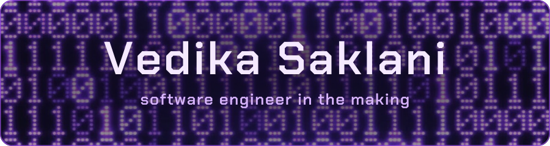

I build backend systems and full-stack features, from APIs and databases to CI and deployment.

BTech Computer Science (Cybersecurity) at **VIT**, Class of 2028 · CGPA **9.64**

[Email](mailto:ivedikasaklani@gmail.com) · [GitHub](https://github.com/vedikasaklani)

---

## About Me

I love falling into a rabbit hole and spending a whole week on one project. I like niche work and I like being a generalist. Anything that teaches me something new is fair game, which means I like a lot of things.

I'm looking to start contributing to open source soon. If you have a project and want a collaborator, [email me](mailto:ivedikasaklani@gmail.com) right now. No, actually, I'm interested, and I'll build. Bye!

---

## Skills

**Languages**

**Web and Backend**

**AI and LLM**

**Data and Tools**

---

## Projects

### [AI Commerce Agent: OAuth-Protected MCP + Razorpay](https://github.com/vedikasaklani/chatbot-and-mcp-agent-commerce)
[Demo video](https://drive.google.com/file/d/14w8QHVQa3Rht66EuI3LCjxFGqK71NW1n/view)

`FastAPI` `SQLAlchemy` `PostgreSQL` `Razorpay` `WorkOS OAuth` `MCP`

- OAuth-protected MCP server (WorkOS bridge) that lets external AI clients like Claude authenticate and place purchases via function calling.
- Multi-turn agent that searches products, manages the cart and places orders, with per-user memory, a full audit log and a decision record per order.
- Razorpay checkout with webhook signature verification and idempotent event handling. The server validates every payment itself rather than trusting model output.
- Deployed as three Render services, with a Pytest suite in GitHub Actions CI (webhook rejection, payment verification, rollback on provider failure or order-cap breach).

### [MCP Server Trust Registry](https://github.com/vedikasaklani/mcp-server-exasol)
[Demo video](https://drive.google.com/file/d/1R9sLmjSL_2GYnYjBkptb0quM3jcn2iWk/view?usp=sharing)

`FastAPI` `PostgreSQL` `Exasol` `SQLAlchemy` `GitHub App Webhooks` `Alembic` `Docker`

- Registry that scans third-party MCP servers on every GitHub push (static rules + LLM behavioral analysis) and assigns a daily trust score.
- GitHub App webhook flow (signature verification, private-repo cloning via installation tokens) and a two-phase scan pipeline integrating the Cisco `mcp-scanner`.
- SQL star schema in an Exasol warehouse, fed by a best-effort PostgreSQL to Exasol sync so an analytics outage never fails a committed scan.

### [depSCAN](https://github.com/vedikasaklani/depSCAN)
Frontend Lead

`React` `Recharts` `REST APIs`

- Built the Project View (scan history, ecosystem filtering, NTIA compliance overview) and the Vulnerability Dashboard (CVE table with CVSS, affected packages, fix versions, dependency graph, report export).
- Wired both views to live SBOM-scan APIs and managed version control for a team of 6.

### [PDF-to-Video Learning Recommender](https://github.com/vedikasaklani/tutorial-recommender)

`Python` `spaCy` `PyPDF` `Hugging Face API` `YouTube Data API`

- NLP pipeline: chunks PDFs with spaCy, ranks chunks by embedding similarity, and prompts an LLM to generate YouTube queries. Results are deduplicated and ranked.
- Chrome/Firefox extension that recommends videos for the active tab's PDF via a Flask REST API.
